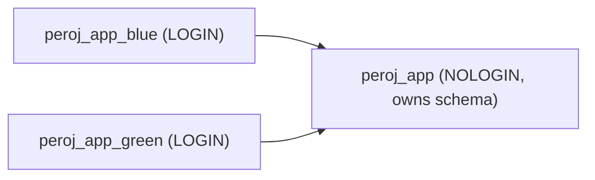
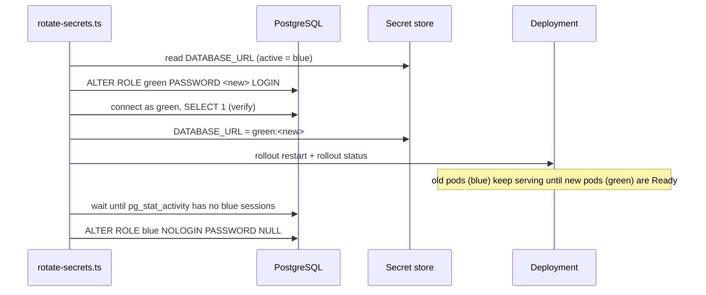

# Secret Rotation Runbook

This runbook describes how PERO-J rotates credentials **without service downtime** using [`backend/scripts/rotate-secrets.ts`](../backend/scripts/rotate-secrets.ts).

| Secret | Strategy | Cadence | Command |
|---|---|---|---|
| PostgreSQL password (`DATABASE_URL`) | Dual-user (blue/green) rotation | Every 90 days, or immediately on suspected leak | `db` |
| Admin API key (`API_ADMIN_KEY`) | Two-phase with overlap window | Every 90 days / staff offboarding | `api-key` → `api-key:finalize` |
| Hot wallet key (`HOT_WALLET_SECRET`) | Add new signer → deploy → remove old signer | Every 30 days / suspected compromise | `hot-wallet` → `hot-wallet:finalize` |

> [!IMPORTANT]
> The script never prints secret values unless `--reveal` is passed. All log output masks keys (`****abcd`) and redacts passwords from connection strings.

---

## 1. Prerequisites

```bash
cd backend/scripts
npm install
```

| Requirement | Why |
|---|---|
| `kubectl` with `get`/`patch` on the Secret and `rollout` on the Deployments | `k8s` backend (default) |
| `docker compose` v2.1+ | `env-file` backend |
| `DB_ADMIN_URL` — connection string for a role with `CREATEROLE` | Altering the app users' passwords |
| `HORIZON_URL`, `NETWORK_PASSPHRASE` | Hot wallet rotation |

Common flags:

```
--backend k8s|env-file   --namespace pero   --secret pero-secrets
--deployments pero-indexer,pero-api   --env-file .env   --dry-run
```

Always run with `--dry-run` first to review the plan.

---

## 2. PostgreSQL — dual-user rotation

### Why two users?

Changing the password of the user that running pods are connected as would break any pod that reconnects before it receives the new secret. Instead we keep **two login users** that share one owner role:



Only one user is *active* (in `DATABASE_URL`) at a time. Rotation always changes the password of the **standby** user, so the active user is never disrupted.

### One-time setup

```bash
DB_ADMIN_URL=postgres://admin:***@db:5432/peroj \
  npx tsx rotate-secrets.ts setup-db
```

This idempotently creates `peroj_app` (NOLOGIN) and `peroj_app_blue` / `peroj_app_green` (LOGIN, member of `peroj_app`, `SET role = peroj_app` so new objects are owned by the shared role). Then transfer existing objects:

```sql
REASSIGN OWNED BY <current_app_user> TO peroj_app;
```

Override names with `DB_OWNER_ROLE` and `DB_APP_USERS=user_a,user_b`.

### Rotation sequence



```bash
DB_ADMIN_URL=... npx tsx rotate-secrets.ts db --namespace pero --deployments pero-indexer --dry-run
DB_ADMIN_URL=... npx tsx rotate-secrets.ts db --namespace pero --deployments pero-indexer
```

### Safety guarantees

* **Verification before publish** — the new credentials are tested with a real login before the secret is touched. A failure leaves everything unchanged.
* **Automatic rollback** — if `rollout status` fails, the previous `DATABASE_URL` is restored and the deployment is rolled again. The previous user is still valid at that point.
* **Drain before lock** — the previous user is only locked once it has zero sessions (`--drain-timeout`, default 300 s). If sessions linger, its password is set to expire in 1 hour and a warning is logged.

---

## 3. Admin API key — two-phase rotation

The indexer accepts both `API_ADMIN_KEY` and `API_ADMIN_KEY_PREVIOUS`, so clients can migrate during an overlap window.

```bash
# Phase 1 — new key becomes primary, old key still accepted
npx tsx rotate-secrets.ts api-key --namespace pero --reveal
# → distribute NEW_API_ADMIN_KEY to operators / CI secrets

# Phase 2 — after all clients are updated
npx tsx rotate-secrets.ts api-key:finalize --namespace pero
```

Or in a single run with an automatic overlap: `api-key --overlap 3600`.

A new rotation refuses to start while `API_ADMIN_KEY_PREVIOUS` is still set, preventing accidental revocation of a key that clients are still using.

---

## 4. Hot wallet — signer rotation

The account address never changes; only its signing key does. Services must use `HOT_WALLET_ADDRESS` as the transaction source account and `HOT_WALLET_SECRET` to sign.

```bash
# Phase 1 — add new key as signer (same weight), publish it, roll services
HORIZON_URL=https://horizon.stellar.org NETWORK_PASSPHRASE="Public Global Stellar Network ; September 2015" \
  npx tsx rotate-secrets.ts hot-wallet --namespace pero

# Verify on-chain that new transactions are signed by the new key, then:
npx tsx rotate-secrets.ts hot-wallet:finalize --namespace pero
```

Finalize removes the old signer (or sets `masterWeight` to 0 if the old key was the master key), signed by the new key.

> [!CAUTION]
> On suspected compromise, run both phases back-to-back immediately and move funds above the operating float to cold storage.

---

## 5. docker-compose / single host

Use the `env-file` backend; services are recreated one at a time with `docker compose up -d --no-deps --force-recreate --wait`:

```bash
npx tsx rotate-secrets.ts db --backend env-file --env-file ../../.env --deployments indexer
```

The `.env` file is rewritten atomically with mode `0600`.

---

## 6. Staging verification procedure

Run this checklist in staging before every production rotation and after any change to the script.

1. `npx tsx rotate-secrets.ts status --namespace pero-staging` — record the active DB user.
2. Start a synthetic load: `k6 run tests/load/api_load_test.js` (or `watch -n1 curl -fsS $INDEXER/health`).
3. `DB_ADMIN_URL=... npx tsx rotate-secrets.ts db --namespace pero-staging`.
4. Confirm:
   - [ ] zero non-2xx responses in the load test during rotation
   - [ ] `status` shows the other DB user as active
   - [ ] `SELECT rolcanlogin FROM pg_roles WHERE rolname = '<previous user>'` returns `false`
   - [ ] `/health` reports `db: connected`
5. `api-key --reveal` → call `POST /api/contracts` with **old** key (200) and **new** key (200).
6. `api-key:finalize` → old key returns 401, new key returns 200.
7. `hot-wallet` → `hot-wallet:finalize` on testnet; confirm signer list on Horizon (`/accounts/<address>`) contains only the new key.
8. Record the run (date, operator, results) in the change log.

## 7. Emergency rollback

| Situation | Action |
|---|---|
| DB rollout failed | Script restores the previous `DATABASE_URL` automatically. If the script was interrupted, set `DATABASE_URL` back to the user named in `DATABASE_URL_PREVIOUS_USER` and `ALTER ROLE <user> LOGIN PASSWORD '<known>'`. |
| Clients broke after `api-key:finalize` | Re-add the old key as `API_ADMIN_KEY_PREVIOUS` and roll the deployment. |
| Hot wallet services can't sign after phase 1 | Old key is still a valid signer; restore `HOT_WALLET_SECRET` from `HOT_WALLET_SECRET_PREVIOUS` and roll. |
